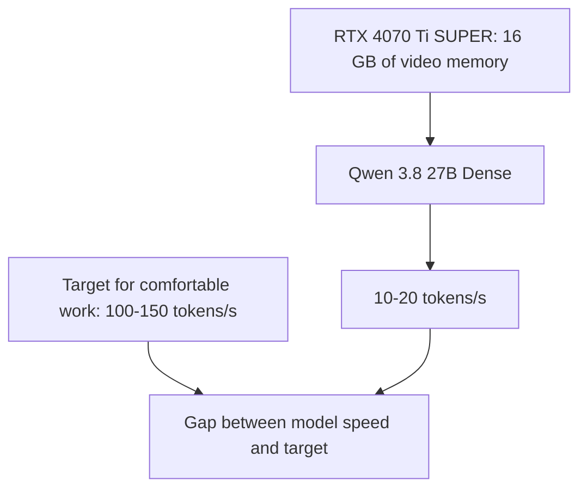
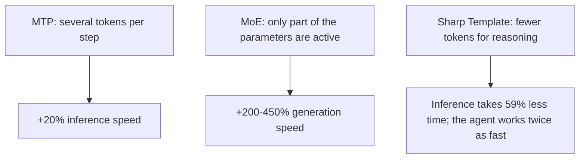
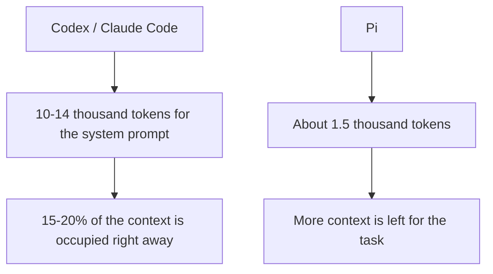
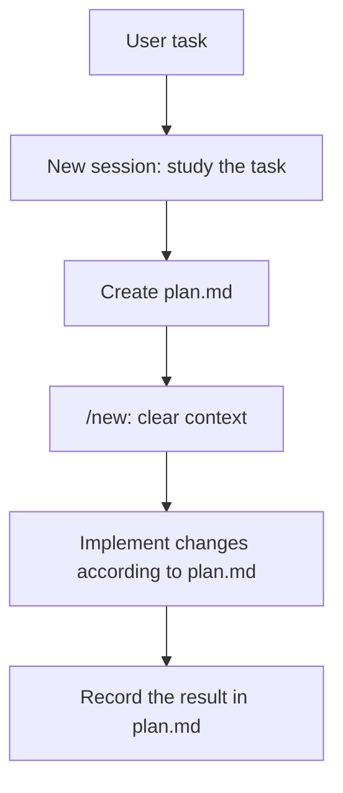
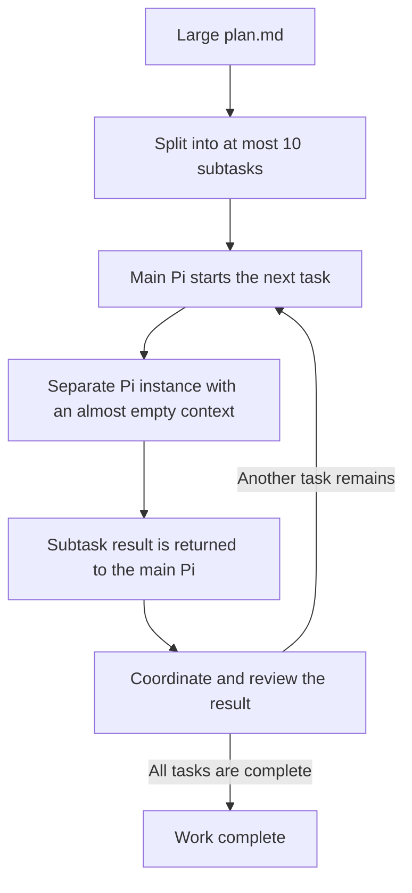
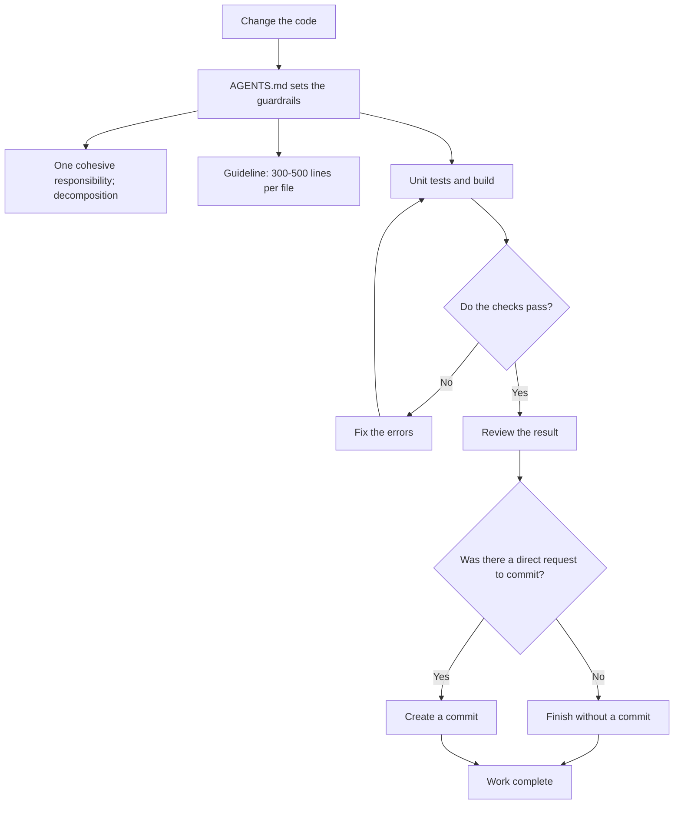
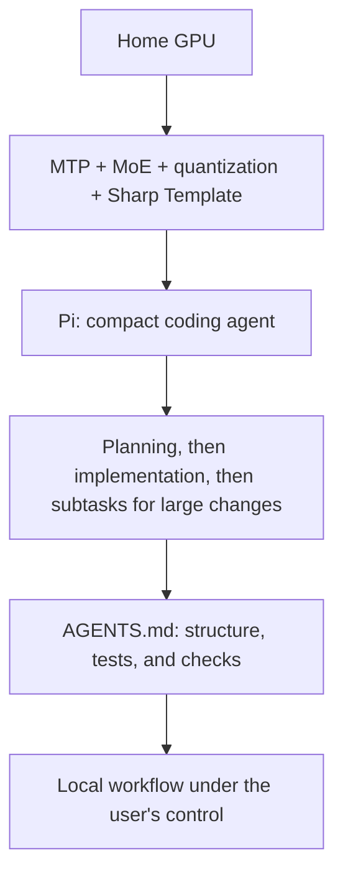

# 125 Tokens per Second on an RTX 4070 Ti SUPER: How I Got a Local LLM Working as a Full-Fledged Coding Agent

Based on statistics, among regular desktop PC users, the most common graphics card has 16 GB of video memory. According to GaugeDB surveys, such cards make up 27.21% of the market. I happen to have an NVIDIA GeForce RTX 4070 Ti SUPER with 16 GB of GDDR6X video memory, which currently costs $900. Until now, the main problem was that it was impossible to run an LLM agent on a graphics card of this class that was smart enough and fast enough. If you run a smart model like Qwen 3.8 27B (Dense architecture), you get 10-20 tokens per second. And for comfortable work with a coding agent, you need 100-150 tokens per second.



But recently I came across 2 models: Tiel-Coder-35B-A3B-GGUF-MTP (built for coding) and Cyber-Tiel-Coder-35B-A3B-GGUF-MTP (an uncensored abliterated model that doesn't refuse to write exploits or carry out active hacks on anything you ask it to). And what else is notable about them? First, they use MTP (Multi-Token Prediction), a technology that lets an LLM predict several next tokens at once instead of one, which increases inference speed by 20%. Second, they use the MoE (Mixture of Experts) architecture, which makes it possible to get the quality of a large model while performing computations for each token with only part of its parameters. Token generation speed increases by +200-450%. Third, there's Sharp Template, an optimized Chat Template (Jinja) with a system prompt that makes the LLM spend fewer tokens on reasoning and answers without losing necessary information. It cuts inference by 59%, which ultimately makes a coding agent work 2 times faster.



So, on my graphics card, I run the following versions of these models: Cyber-Tiel-Coder-35B-A3B-MTP-UD-Q2_K_XL.gguf and Tiel-Coder-35B-A3B-MTP-UD-Q2_K_XL.gguf, and the launch parameters look like this:


As a result, I get a speed of 125 tokens per second!


This is a very good start, but as you may have noticed, the context window is only 65535 tokens, which is a bit too small for agent-assisted coding. That's why I use 3 approaches.

First, I don't use heavy coding agents, such as Codex or Claude Code, because right out of the box, with the slightest interaction, they consume 10 to 14 thousand tokens for the system prompt and so on. That is, 15-20% of the context is taken up immediately, and local models also lose context more easily, while such large system instructions distract them even more from the task the user describes. I use the Pi coding agent. It requires 1.5 thousand tokens to run, which is 10 times less than Codex or Claude Code, and this noticeably affects the capabilities and quality of work on the user's local GPU. Here's Pi's configuration file for adding these 2 models that will run on your GPU: ~/.pi/agent/models.json

```json
{
  "providers": {
    "lmstudio": {
      "baseUrl": "http://YOUR_LOCAL_IP:1234/v1",
      "api": "openai-completions",
      "apiKey": "lmstudio",
      "models": [
        { "id": "peculiar-ragdoll/tiel-coder-35b-a3b-mtp@q2_k_xl" ,
          "contextWindow": 65536,
          "maxTokens": 32768,
          "input": ["text", "image"]
       },
        { "id": "peculiar-ragdoll/cyber-tiel-coder-35b-a3b-mtp" ,
          "contextWindow": 65536,
          "maxTokens": 32768,
          "input": ["text", "image"]
       }
     ]
   }
  }
}
```



Second, I never ask the coding agent to try to make a large code change directly. I start a new session with the "/new" command and ask the coding agent to write a plan.md file describing what needs to be changed in the code to implement the task I gave it. That way, the 65535-token context window is enough for me, since, essentially, I split the task into two phases: planning and implementation. Then, if the task isn't too large, after creating plan.md I clear the coding agent's context window with the "/new" command and ask it to make the code changes based on plan.md and record the results in plan.md when it's done.



Third, for very large plan.md files, I use my SKILL called subtask4llm-pi, which breaks a task into no more than 10 subtasks and runs them sequentially. Each subtask runs in a separate coding agent instance, which receives only what is relevant to that subtask, so its 65535-token context window is almost empty. The subtask results flow into the main Pi instance without overflowing its main context window, which handles coordination, planning, and checking. You can install the skill with the command "npx skills add https://github.com/evgenyigumnov/subtask4llm --skill subtask4llm-pi". There is also a version for Codex, subtask4llm-codex. By the way, if anyone wants to add support for Claude or help in some other way, send pull requests: https://github.com/evgenyigumnov/subtask4llm



Fourth, I use the approach of Robert Martin, author of "Clean Code", who recently said that he had stopped reading code generated by coding agents. He managed that by putting LLMs in a tight box. Using these constraints, you can offset the fact that the models in use are heavily compressed to the UD-Q2_K_XL level. That is, they make more mistakes than 4-, 6-, or 8-bit models. To create these constraints, I suggest using AGENTS.md, which controls the size of every file being created, makes you write unit tests, clearly spells out decomposition and responsibility in the code, and ultimately requires running the tests. Since we don't pay for every token on a local GPU, we can easily afford a couple of extra iterations while the model sees its mistakes and fixes them. Here is a basic example of an AGENTS.md file for this:

```
# AGENTS.md

## Code Writing Rules

- Maximum size of one code file: 300-500 lines. If a file gets bigger, break it down.
- The main principle: one cohesive responsibility per module.
- Don't sacrifice logical cohesion or code readability to comply with arbitrary line-count limits.
- Split files based on their functional purpose, not just their line count.
- All functions must be covered by unit tests.
- When adding or changing functionality, or fixing bugs, always add the corresponding unit tests.

## Checks Before Submission

- All tests and the build must pass without errors or warnings.
- Don't weaken checks or delete tests just to get them to pass.

## Main Rule

**Never commit changes without a direct request from the user.**
```



In the end, we got a synergistic effect, or you could even call it emergence. MTP + Quantization + MoE + AGENTS.md (Clean Code) + Sharp Template + Pi agent + subtask4llm skill + plan.md =
a workflow with a coding agent, running on your home graphics card. Now your source code is under your control, and big corporations won't get their dirty paws on it! And you can also run an abliterated model for White Hat hacking without putting up with constant refusals from proprietary models when you're trying to hack something.


